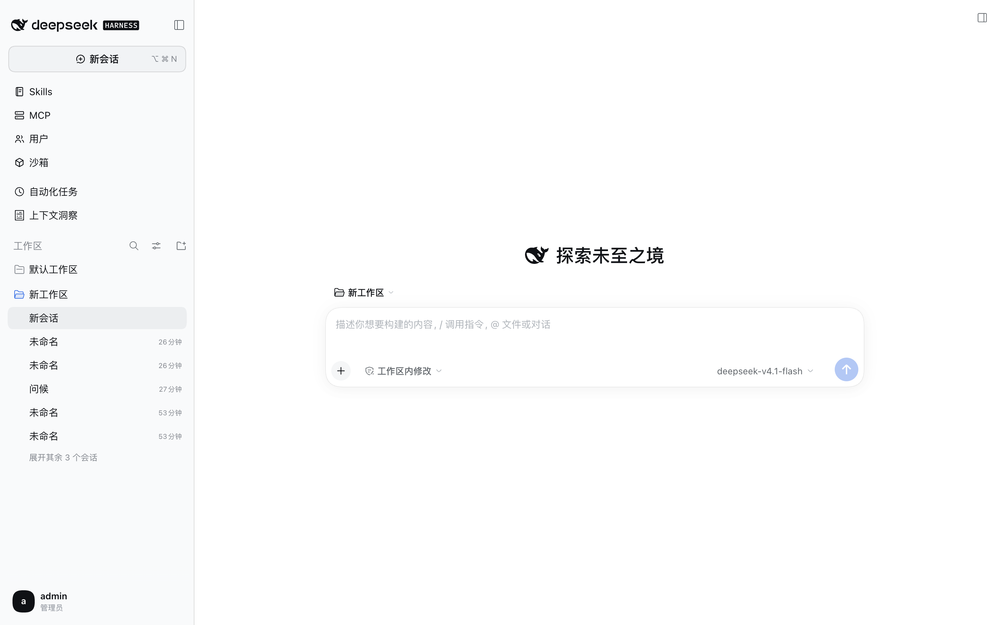
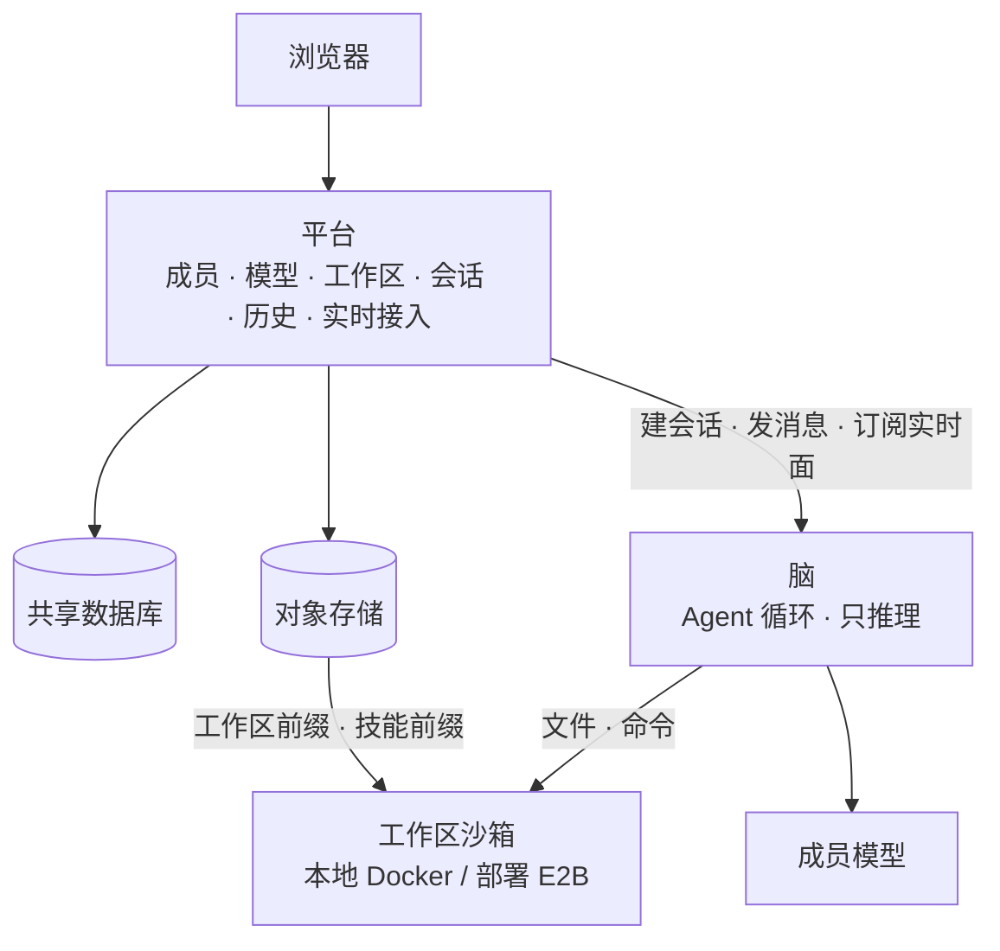
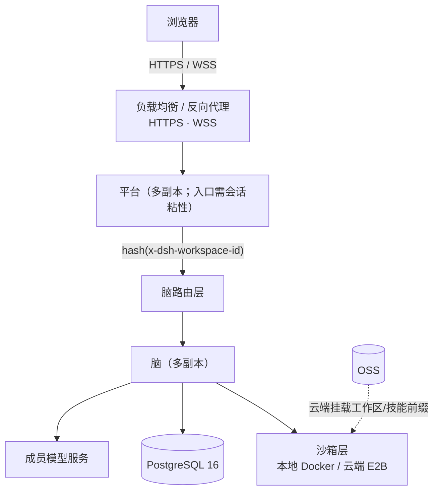

# Agent 平台（dsh-sandbox-platform）

一个多用户的 Agent 产品。人只和平台打交道：登录、管理自己的工作区、在会话里对话、配置模型、技能和 MCP。平台把会话交给脑去推理，把归属和历史留在自己这里。

- 运行时：Node.js 24.9+；本地默认 SQLite，部署用 PostgreSQL 16
- 浏览器界面：DSH 客户端 UI（与脑使用的 DSH 内核版本对齐，当前 `0.2.2-rc.3`）



## 设计思路

**平台是产品的入口。** 成员、模型、工作区、会话归属、技能和 MCP 都是平台保管的产品数据，比任何一台推理进程活得更久。

**推理是可替换的运行时。** 平台把「这是谁、哪个工作区、用哪套模型」交给脑。脑可以多副本、可以重启，平台不把模型循环嵌进自己的进程。平台到脑以工作区 id 为路由键：同一工作区的请求尽量落到同一台脑，避免同一块工作区的写租约和沙箱在副本之间来回跳。平台只配置一个 `brain.baseUrl`，指向脑的路由层；脑扩缩容不需要改平台配置。

**隔离单位是工作区。** 一个工作区一份持久存储（本地目录、OSS 前缀或 E2B 卷）、一台按需创建的沙箱；同一工作区里的会话共享文件，不同工作区互不可见。

**历史不依赖某台机器。** 会话内容写在共享数据库里，打开以前的对话不需要当时那台脑还活着。

平台依赖 [dsh-sandbox-brain](https://github.com/lishuo0/dsh-sandbox-brain)，通过 `/brain/v1` 交接会话。脑怎么实现，见该仓库的文档。

浏览器不直接连脑：平台确认会话归属后，带着用户、工作区和模型配置去调脑，再把输出转给浏览器。

## 架构

### 业务架构



浏览器只连平台；平台确认会话归属后，带着用户、工作区和模型配置调脑；脑把文件读写和命令执行送进这个工作区的沙箱。成员、模型、工作区、归属和已写完的历史留在平台和共享数据库，对象的字节留在对象存储，沙箱只挂载本工作区与技能对应的存储前缀（脑的 profile 去掉 OSS 挂载时才退回预建卷）。

### 部署架构



平台只配置一个 `brain.baseUrl`，指向脑路由层。路由层按请求头里的 `x-dsh-workspace-id` 做一致性哈希，同一工作区的请求——包括会话级 WSS 的 Upgrade 和它的带内答复——固定落到同一台脑，这样写租约、沙箱绑定和待答请求不会在副本之间来回跳。目标脑不可达时才漂移到下一台；会话可以用同一个 `sessionId` 从共享数据库恢复，正在跑的这一轮需要重发。

平台自己的多副本入口需要**会话粘性**：同一个浏览器的实时连接（`P/socket`）在生命周期内固定在一台副本上，该副本内存里存着这个成员的订阅与待答路由表；连接落到另一台副本就会重新建流。审批答复走同一条连接，不会漂移。对象存储也要用共享 OSS（`aliyun.oss`），否则附件和工作区文件只留在某一个副本的本地磁盘上。

本地开发通常只起一台脑，沙箱由本机 Docker daemon 提供；多副本部署用 E2B，因为本地 `storage.dir` 是单机目录，不适合多台脑共享。

## 能力

| 能力 | 说明 |
|---|---|
| 用户 | 首个管理员由部署配置录入；之后由管理员添加成员、重置密码、停用账号、调整角色 |
| 模型 | 每人配置自己的接口地址、密钥和模型名；密钥只存密文 |
| 工作区 | 一个人可以有多个工作区；每个工作区一份持久存储、一台按需创建的沙箱，并可选接入哪些技能和 MCP |
| 会话 | 工作区下可以有多条会话；可以看历史、发送、停止、接收实时输出 |
| 技能 | 按条上传、启用、停用；本人的技能盖过同名的公共技能 |
| MCP | 按条配置远程 HTTP 服务；请求头里的密钥加密保存 |

## 部署启动

本地需要 Node.js 24.9+：`config.yaml` 不写数据库时就用仓库里的一个 SQLite 文件，不用安装数据库。脑的本地沙箱默认用 Docker（按需为每个工作区起一个容器，首次会拉取 `node:22-bookworm-slim`），需要可用的 Docker daemon；不可用时回退 mock（没有安全隔离）。部署和多副本在 `config.yaml` 里加 `database.url` 换成 PostgreSQL 16，并配好 `aliyun.oss` 让对象跨副本共享；平台入口还要把同一浏览器的实时连接粘到同一副本（`P/socket` 依赖进程内订阅）。平台和脑是两个仓库，命令都在各自目录下跑；两个 `dev.sh` 都把进程放后台，命令返回后服务已经在跑，关掉终端不影响。

```bash
# 1. 平台：装依赖并启动，监听 3000
cd dsh-sandbox-platform
npm install
./scripts/dev.sh
# 输出里有一行 admin=... 和 password=...，登录就用它
```

起脑之前先对齐凭据：打开平台目录下的 `config.yaml`，把 `credentialsKey` 和 `brain.appId` / `brain.appKey` 填到脑的 `config.yaml` 的 `credentialsKey` 和 `platform.appId` / `platform.appKey`。`appId` / `appKey` 不一致会在鉴权层直接拒绝；`credentialsKey` 不一致要等到解密 MCP 请求头时才失败，脑只打一条告警、对应密钥头不可用，更难排查。

```bash
# 2. 脑：装依赖并启动，监听 8080
cd ../dsh-sandbox-brain
npm install
./scripts/dev.sh
```

日志在各自的 `var/log/`。两边默认指向同一个 SQLite 文件（`dsh-sandbox-platform/var/dsh.sqlite`），`brain.baseUrl` 也已经对上，不用改。

## 使用

1. 浏览器打开 `http://127.0.0.1:3000`，用启动时打印的 admin 账号和密码登录。
2. 配模型：每位成员一份，存在平台里。登录后点左下角账号菜单里的「模型」（DSH 客户端设置面板），填接口地址、鉴权密钥、模型列表和默认模型；也可以跑下面「脚本 → 真实模型」那条完整命令，脚本会替你保存（存到 admin 名下）。
3. 点侧边栏工作区标题旁的「+」新建工作区，顺便搜索并添加这个工作区里可用的技能和 MCP；然后在文件树里上传或整理文件。
4. 在工作区里打开会话，发送消息、查看历史、停止当前这一轮。
5. 按需添加技能和 MCP，对之后新建的会话生效；工作区只使用创建时选中的那些。

产品层面的完整说明见 [平台架构](./docs/平台架构.md)，定时提醒见 [定时任务](./docs/定时任务.md)，不接阿里云在本机跑全链路的细节见 [本地联调](./docs/本地联调.md)，genui / context 两个插件的接入方案见 [genui 与 context 接入](./docs/genui与context接入.md)。

## 配置

唯一配置在 `config.yaml`，字段旁有注释。密钥留空时由 `ensure-config` 生成。

数据库不写就是用本地 SQLite（自动创建 `var/dsh.sqlite`）；写 `database.url` 就接 PostgreSQL；也可以写 `database.file` 换 SQLite 文件位置。和脑共用的配置：数据库、`credentialsKey`、`brain.appId` / `brain.appKey`；本地还要让两边 `storage.dir` 指向同一处，部署还要让 `aliyun.oss` 与 `aliyun.sandbox` 对齐。两边的 DSH 版本也要一致（当前都是 `0.2.2-rc.3`）。

模型密钥不在配置里：每个成员在平台上保存，平台加密后传给脑。

## 脚本

下面每条命令都在 `dsh-sandbox-platform` 目录下执行。除了起停，其余脚本都要连服务，跑之前先按「部署启动」把平台和脑起好。

### 起停：`./scripts/dev.sh`

```bash
./scripts/dev.sh          # 启动平台（3000），已在跑就跳过；输出里有 admin 账号和密码
./scripts/dev.sh status   # 看 SQLite 文件（或 PostgreSQL）和 3000
./scripts/dev.sh stop     # 停掉平台；数据库是 PostgreSQL 时一并停掉
```

配置里没有 `database.url` 时不启动任何数据库进程；写了 `url` 才会按需拉起 PG。

平台仓库的这个脚本不管脑；脑用脑仓库里的同名脚本起停。

### 自检：`node scripts/smoke.mjs`（不调模型）

不需要模型，只验平台、数据库、脑这条链路：

```bash
node scripts/smoke.mjs
# smoke-ok workspace=workspace-... session=session-...
```

它用 `config.yaml` 里的 admin 登录，建工作区、写文件、读回、让脑开一条会话。看到 `smoke-ok` 就说明链路通了；失败会指出卡在哪一步。

还没配模型时，它会写一条占位配置并告警，只为把会话开起来，不会真的调用模型；后面配真实模型会覆盖它。

### 真实模型：`node scripts/real-model-smoke.mjs`（会真的调用模型）

一条完整命令，模型四样一起给上，`DSH_MODEL_KEY` 换成你自己的密钥：

```bash
DSH_REAL_MODEL_SMOKE=1 \
DSH_MODEL_BASE_URL=https://api.deepseek.com/v1 \
DSH_MODEL_IDS=deepseek-chat \
DSH_MODEL_DEFAULT=deepseek-chat \
DSH_MODEL_KEY=这里换成你的模型密钥 \
node scripts/real-model-smoke.mjs
```

带了 `DSH_MODEL_*` 时，脚本先把模型存到 admin 名下，然后建一条技能、一个工作区、一条会话，发一句话，等模型把回复写回来；成功打印 `real-model-smoke-ok session=...`。

模型已经配过时，`DSH_MODEL_*` 可以全部去掉，只留 `DSH_REAL_MODEL_SMOKE=1`。想配多个模型名就把 `DSH_MODEL_IDS` 写成逗号分隔，`DSH_MODEL_DEFAULT` 必须是其中之一。

不带 `DSH_REAL_MODEL_SMOKE=1` 时脚本直接退出，防止在没配模型的机器上误调用。服务没起、或 admin 还没配模型，它会打印下一步该做什么然后跳过（不算失败）。默认等 120 秒，可用 `DSH_REAL_MODEL_TIMEOUT_MS` 调整；全程不打印密钥。

## 测试

三条命令各管一件事，都在 `dsh-sandbox-platform` 目录下跑，不需要先把平台或脑启动起来：

```bash
npm run typecheck    # 类型检查
npm run test:unit    # 单元测试，不依赖外部数据库服务
npm run test:e2e     # 端到端测试，默认用临时 SQLite
```

- **`npm run typecheck`**：只做类型检查（`tsc --noEmit`），不执行测试。改完代码先跑它，类型写错会直接报出来。
- **`npm run test:unit`**：跑 `test/unit`，不依赖外部服务的纯逻辑测试——口令、令牌、加密、帧编解码、路径、对象存储、SQLite 翻译等。不连外部数据库服务、不连脑；部分用例会建临时 SQLite，随时可跑。
- **`npm run test:e2e`**：跑 `test/integration` 和 `test/e2e`。默认给每个测试文件建一个临时 SQLite 文件，覆盖登录、成员管理、模型配置、工作区文件、技能、会话，以及和脑的联合契约；跑完自动删除。
- `npm test` 等于一次跑完所有测试（不含 typecheck）。
- 要回归 PostgreSQL 方言，加 `TEST_DB=postgres`：会自动拉起临时 PostgreSQL（端口 55432，用户 `dsh`，数据目录 `.test-pgdata`），跑完停库，不碰你开发用的 `var/pg`。
- 本机没装 PostgreSQL 16 时，PG 模式会自动改用仓库内 `.test-pg-bin` 下的预编译二进制；也可以用 `TEST_PG_PORT`、`TEST_PG_USER`、`TEST_PG_DATA`、`TEST_PG_BIN` 换测试库的端口、用户、数据目录和二进制路径。
