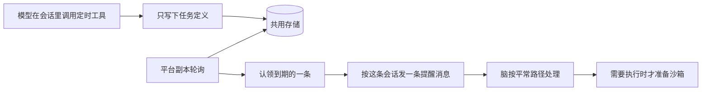
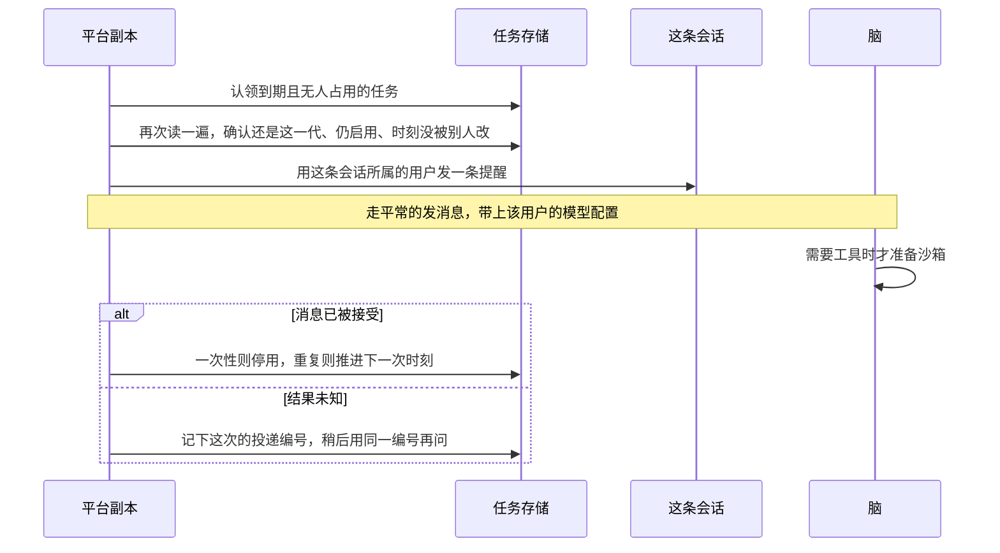
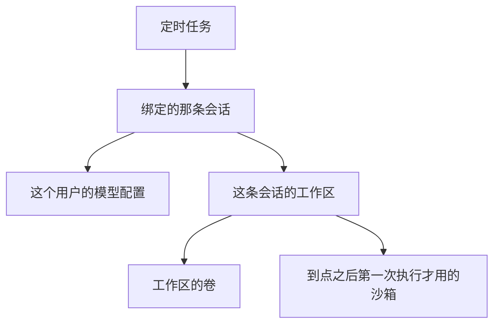

# 定时任务

定时任务挂在某一条会话上。到点之后，不是脑自己把会话叫醒，而是平台把一条提醒送回这条会话，后面的推理和沙箱与平常发消息相同。

官方那种「计时器跑在脑进程里、到点直接唤醒本进程里的 Agent」不用。脑副本可以随时被杀掉，计时器会跟着消失，而且唤醒时补不齐这个用户的模型配置。脑也不回调平台。

---

## 1. 谁做什么

| | 做 | 不做 |
|---|---|---|
| 脑 | 在当前会话上创建、修改、列出、删除任务定义 | 不自己计时，不唤醒会话，不回调平台，不碰沙箱 |
| 平台 | 认领到期任务，把提醒当成这条会话的一条用户消息发出去 | 不直接创建沙箱，不调用脑的内部计时器 |
| 沙箱 | 这条提醒如果需要读文件或跑命令，仍走该工作区的沙箱 | 不保存任务定义，不到点自己跑 |

任务定义和会话绑在一起。到期之后的执行环境，就是这条会话所属的工作区：模型配置用这个用户的，文件和命令进这个工作区的沙箱。

子代理不能创建或修改定时任务。提醒必须落在平台认得的那条主会话上。

---

## 2. 任务长什么样

一条任务有标题、要执行的提示、规则、状态，以及下一次应该触发的时刻。规则有六种：

| 种类 | 含义 | 触发几次 |
|---|---|---|
| 延迟 | 从现在起过若干秒 | 一次 |
| 定点 | 一个明确的时刻 | 一次 |
| 间隔 | 按固定秒数重复，锚在创建或修改的时刻 | 重复 |
| 每天 | 某个时区里的一个钟点 | 重复 |
| 每周 | 指定星期几的一个钟点 | 重复 |
| cron | 五段表达式，加一个时区 | 重复 |

间隔最短 60 秒。更密的规则拒绝。时区用 UTC 或 IANA 地名，例如 `Asia/Shanghai`。定点必须在未来。标题和提示不能是空的。

一次性和重复任务的差别只在发完之后：一次性改为停用；重复任务把下一次时刻往后推，状态仍是启用。

修改规则时，下一次时刻按保存时重新计算。间隔类的锚也改到这次保存的时刻，不沿用创建时的锚。

---

## 3. 到期之后怎么送出去

平台每个副本都跑一个循环，大约每两秒看一次。多副本之间不靠进程里的锁，靠存储上的认领：到期、启用、租约已经空出来的行，一次认领一批，别人已经锁住的跳过。

认领带租约，大约 45 秒。持有者是这台平台副本的名字。认领之后再读一次：代际变了、状态不是启用、或者下一次时刻已经变了，就放开，不发送。

提醒正文标明这是定时消息，带上任务标识、这一次的发生时刻、以及当初写下的提示。模型看到的是一条用户消息，不是一条旁路指令。

发送走平台已经有的发消息路径。这样模型地址、密钥、工作区都会按这个用户补上。沙箱仍在第一次真正读文件或跑命令时才准备，定时循环本身不创建沙箱。

---

## 4. 失败时不发第二遍

消息的结果和会话消息一样，可能是接受、拒绝、或者未知。

| 结果 | 处理 |
|---|---|
| 已接受 | 推进下一次，或把一次性任务停用 |
| 未知 | 保留同一次投递编号。下次认领用这个编号再送，平台的幂等会认出是同一条，不会让命令再执行一遍 |
| 拒绝，或规则算不出来 | 记一次失败。连续失败到 5 次就停用 |
| 会话已经不在，或归档 | 暂时按住，不推进，也不当成新的一次执行 |
| 用户还没配模型 | 按住，等配置齐了再试 |

推进下一次时刻时要带上认领时的代际。代际对不上就放弃这次推进。消息如果已经收下，只补记投递编号，不换一个新编号重发。

---

## 5. 和会话、沙箱的关系

任务不单独拥有一台沙箱，也不单独拥有一把模型密钥。它只是在未来的某个时刻，替用户往这条会话里放一句话。话进去之后，手脑分离、工作区隔离、多副本恢复都和人自己发消息相同。

脑重启不影响已经写下的任务，因为定义不在脑的内存里。平台重启也不丢任务，认领过期之后别的副本可以接着认领。
