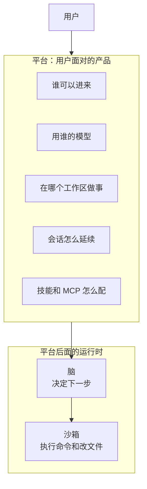
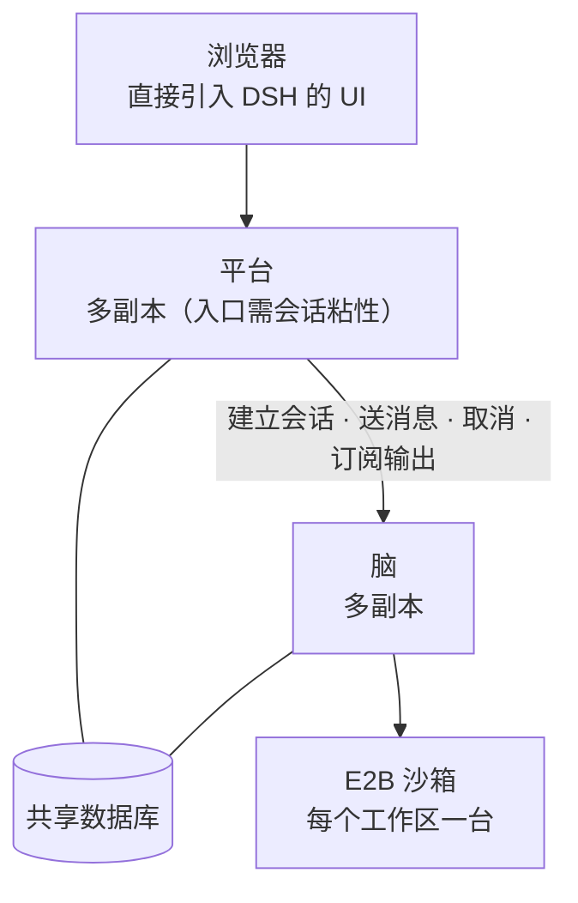
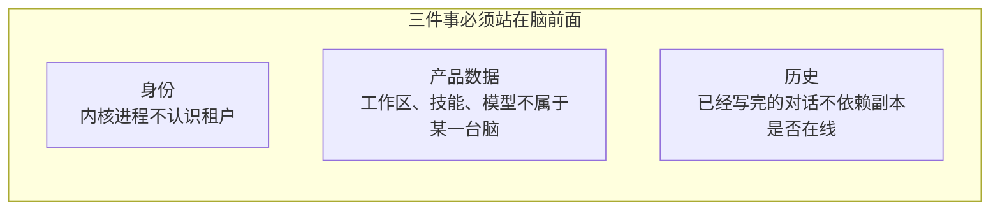
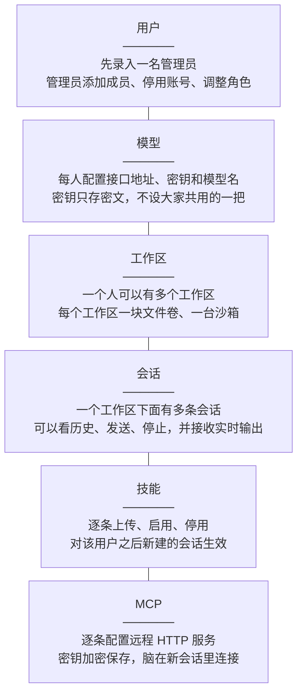
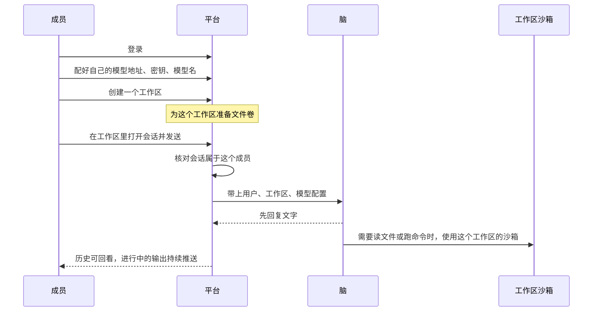
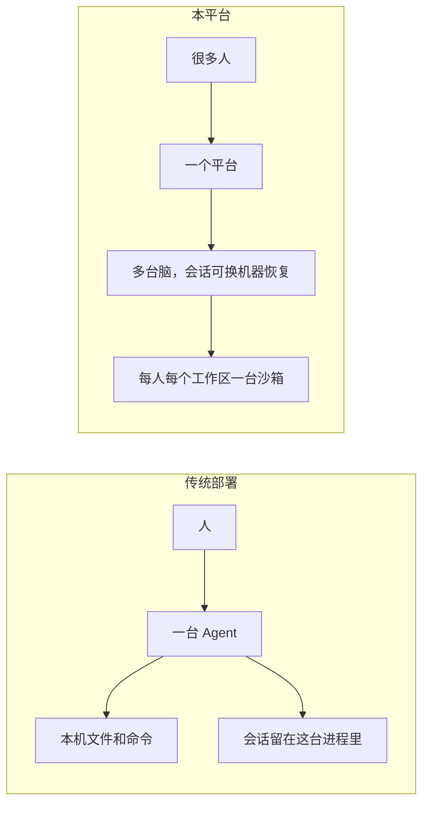

# 平台架构

这是一个多用户的 Agent 平台。人登录的是平台，不是某一台 Agent 机器。平台负责这个产品是谁在用、用哪套模型、在哪个工作区里做事、技能和 MCP 怎么配。想下一步的是脑，真正读文件和跑命令的是这个工作区的沙箱。

脑和沙箱怎么实现，见 `dsh-sandbox-brain` 仓库的 [技术方案](https://github.com/lishuo0/dsh-sandbox-brain/blob/main/docs/技术方案.md) 和 [阿里云沙箱](https://github.com/lishuo0/dsh-sandbox-brain/blob/main/docs/阿里云沙箱.md)。

---

## 1. 平台是什么

传统做法是把 Agent 本身当成产品：装到一台机器上，配置写在这台机器里，工具就在这台机器上执行，会话也活在这台进程里。一个人一套，或者很多人挤在同一套里。

这里的产品是平台。用户只和平台打交道。平台后面挂着可以水平扩展的脑，以及按工作区隔离的执行环境。用户不部署 Agent，不登录服务器改配置，也不把自己的命令跑在别人的宿主机上。

平台不跑模型循环，也不握住沙箱。它把「这是谁、这个会话属于哪个工作区、这次用哪套模型」交给脑，再把脑的输出还给浏览器。会话列表、历史、标题、成员、技能和 MCP，都由平台保管。打开以前的对话，不需要某台脑正好还活着。

---

## 2. 整体怎么设计

平台、脑、沙箱分成三种角色。平台和脑是两个项目，也分开部署。平台项目引入 DSH 的 UI，并保管成员、模型、工作区和会话。脑项目只放接在内核上的插件和这份部署的 profile，跟着内核的版本走。两边只通过会话运行和同一份数据库交接，不把脑的进程嵌进平台。

| 角色 | 对用户意味着什么 | 自己保管什么 |
|---|---|---|
| 浏览器 | 登录、管理工作区、对话、配置技能和模型 | 不保管业务数据 |
| 平台 | 整个产品的入口 | 成员、模型配置、工作区、会话归属、技能、MCP、历史的读取 |
| 脑 | 用户感知不到某一台副本 | 当前这一轮的推理；会话事实写成日志 |
| 沙箱 | 这个工作区里的命令和文件 | 进程在沙箱里，文件在这个工作区的持久存储上 |

能复用的地方都复用，不另做一套。界面用 DSH 客户端现成的那套，Agent 循环和工具沿用内核，只把文件和命令送进沙箱。用户是谁、历史在哪，仍由平台决定。

平台和脑共用一个数据库，写的内容分开。平台写人和配置，脑写会话发生过的事情、谁正在写这条会话、沙箱绑在哪个工作区。这样平台可以加副本、脑也可以换一台，历史还在。平台多副本时，入口要保证同一浏览器的请求落到同一副本（会话粘性），对象存储要用共享 OSS；审批答复和附件都依赖这两条。

---

## 3. 平台有哪些能力

六项能力各自成块，从上往下看。块与块之间没有先后顺序。

### 用户

系统第一次启动时，按部署配置录入一名管理员。之后由这名管理员添加成员、重置密码、停用账号、把成员升成管理员。至少保留一名可用的管理员。停用立即生效。

成员之间互相看不见对方的工作区、会话、技能、MCP 和模型密钥。管理员可以查看有哪些用户、沙箱属于谁，用来排障，不通过管理入口阅读成员的对话。

这样做是因为脑进程里没有账号体系。如果让每个人直接连脑，就无法回答「这条会话属于谁」。身份放在平台，脑只接受平台声明的用户。

### 模型

每个用户在平台保存自己的模型：接口地址、密钥、模型名。密钥只以密文保存，界面上只出现脱敏后的样子。

建立或恢复会话时，平台把地址、密钥和当前选中的模型名交给脑。脑只放在这一次会话的内存里，写进对话日志的是对话本身，不是密钥。用户没配齐地址和密钥，就不能开新会话。平台不准备一把所有人共用的密钥，也不替用户查询套餐额度。

一个人可以在自己的地址下保存多个模型名，并指定默认模型。会话进行中可以换成其中另一个，之后的轮次用新模型，地址和密钥不变。

### 工作区

一个用户可以有多个工作区。工作区是一个人并行推进的不同事情，也是执行环境的隔离单位：一个工作区一份持久存储、一台按需创建的沙箱。这个工作区里的多个会话共用这台沙箱和这份文件；另一个工作区的会话进不去。

工作区可以归档。归档后不再在里面开新会话，已经发生的对话仍可以回看。

侧边栏工作区标题旁的「+」用来新建工作区：填名称，并在搜索框里挑选这个工作区里的新会话可以使用哪些 Skills / MCP（已选项用卡片列出）。选择按 `(名字, 作用域)` 精确记录，私有条目只能选自己的，公开条目都能选。一个都不选表示这个工作区不接入任何 Skill / MCP——是明确配置过的空列表，不是「沿用全部」。没配置过选择的老工作区和默认工作区仍然沿用全部启用，保证升级后行为不变。

卷在创建工作区时由平台准备好。脑只是在需要执行时把这块卷挂进沙箱，不在用户第一次跑命令时才决定文件存在哪。

### 会话

会话挂在工作区下面。用户在会话里说话，平台确认这条会话属于他，再把消息交给脑。用户可以停止当前这一轮，可以离开后再打开，看到已经发生的历史。侧边栏里的文件树就是这个工作区的卷。文件可以上传进工作区，也可以作为当前消息的附件。输入框上的「+」用来加附件、引用工作区里的文件，以及使用当前会话的命令。

正在生成的半截文字来自当时持有这条会话的脑。已经写完的内容在数据库里，换一台平台、换一台脑都能读。

同一条消息如果结果未知，平台不会自动再送一次。命令可能已经在沙箱里执行过，重送会再执行一遍。

### 技能

技能按条配置：名称、说明、正文和附带文件，可以单独启用或停用。不按文件夹打成合集，直接按工作区选择。分本人和公共两套。本人技能只有自己能改；公共技能由管理员维护，所有成员都能用。同名时本人的那条盖过公共的。

创建沙箱时两套一起挂进去，都是只读。脑先取会话所属工作区选中的技能，再按启用记录决定模型能看见哪些；没配置过选择的工作区沿用全部启用。已经在进行的会话保持开场时的那一份，修改对之后新建的会话生效。

删掉一条技能时，指向它的工作区选择也会一并清掉。

### MCP

MCP 也按条配置：名称、远程地址、超时、请求头。只连接远程的 HTTP 服务。不在脑所在的机器上替用户启动一个本地程序。

请求头里的密钥由平台加密保存。脑在新建会话时连接这个用户已经启用、并且被这个会话所属工作区选中的服务，工具进入这一次对话；没配置过选择的工作区沿用全部启用。某个服务连不上，不阻止会话开始。改配置同样只影响新建的会话，正在跑的会话每轮按最新选择对齐。

删掉一条 MCP 时，指向它的工作区选择也会一并清掉。

---

## 4. 一次使用从平台看

成员还可以在平台上逐条添加技能和 MCP。这些配置不写进某一台脑的本地文件。新建会话时，脑读到的是这个成员当前启用的那一组。

---

## 5. 为什么要这样设计

**人的数据和推理分开。** 成员、密码、模型密钥、工作区、技能、MCP 都是产品数据，会比某一台脑活得更久。放进脑进程里，扩容和重启就要先问「这台机器能不能关」。放在平台，脑变成可以替换的运行时。

**一个平台服务很多人，而不是一个人一套 Agent。** 内核一个进程里可以同时有很多会话，但它不认识租户。租户关系如果后补在工具参数里，读文件时往往只剩下路径，很容易读错人。所以「是谁」在进脑之前就定下来，执行时再按会话找到这个人的工作区。

**工作区是手的边界。** 同一个人会同时开几个会话处理同一件事，这些会话应该看见同一批文件。不同的事不应该挤在一台机器里。所以隔离单位选工作区，不选「整个用户一台」或「每个会话一台」。

**模型属于用户。** 地址和密钥是成员自己的资源。平台保管并在会话开始时交给脑，脑用完即放在内存里。不把一把部署密钥写进脑的环境，让所有人共用额度。

---

## 6. 相比传统 Agent 部署

传统部署通常是下面三种之一：一台机器跑一个 Agent，工具就在这台机器上执行；每个用户单独部署一套完整 Agent；或者很多人共用一个进程、一个目录，没有租户边界。

| | 传统 Agent 部署 | 本平台 |
|---|---|---|
| 谁来部署 | 每个使用者或每台机器一套进程和配置 | 部署一套平台和一组脑，成员由管理员加入 |
| 工具跑在哪 | 和模型同一个宿主机上，模型一调用命令就动到这台机器 | 命令和文件进该工作区的 E2B 沙箱，不动脑所在的机器 |
| 用户之间 | 要么完全分机，要么共享同一目录和同一把密钥 | 工作区之间不同卷、不同虚拟机；密钥、技能、会话按人分开 |
| 会话能不能换机器 | 状态在进程或本机文件里，这台挂了会话就断 | 日志在数据库里，另一台脑可以接上 |
| 模型怎么配 | 写在进程的环境里，大家共用 | 每人在平台配置自己的地址、密钥和模型名 |
| 技能和 MCP | 登录服务器改文件或改启动参数 | 在平台上逐条管理，新建会话时生效 |
| 扩容 | 加用户往往就是再复制一整套 Agent | 平台和脑分别扩展；加脑副本不要求用户重新配置 |
| 历史 | 打在那台 Agent 的界面上，机器不在就打不开 | 历史在平台，不依赖某一台脑还在不在 |

代价也明确。沙箱第一次创建要等待。同一工作区里的会话共享文件，并发写入时后写覆盖。脑重启时，正在跑的这一轮作废，不自动重做已经发生过的命令。这些是把「手」移出宿主机、把会话移出单机进程之后的结果，换来的是多用户和可替换的脑。

---

## 7. 文档怎么分

平台仓库（本仓库）回答：产品是什么、能力有哪些、为什么放在平台、和传统部署差在哪。另有 [定时任务](./定时任务.md) 和 [本地联调](./本地联调.md)。

脑仓库回答运行时怎么落地。[技术方案](https://github.com/lishuo0/dsh-sandbox-brain/blob/main/docs/技术方案.md) 讲手怎样从脑上拆走、E2B 的控制面和机器内执行怎样配合、一个工作区的沙箱怎样创建和复用、多台脑怎样交接同一条会话。[阿里云沙箱](https://github.com/lishuo0/dsh-sandbox-brain/blob/main/docs/阿里云沙箱.md) 讲这台机器在阿里云上怎么造出来、请求怎么进去。
