# 技术方案

本文说明这次要一起落地的运行时：基本会话、手脑分离、E2B 沙箱、常用工具、侧边栏文件系统、文件上传、主会话里的「+」、模型选择、技能和 MCP。平台是什么、有哪些能力，见 [平台架构](./平台架构.md)。

不改内核的 Agent 循环。扩展发生在执行世界：文件、进程、沙箱三处按当前会话进入用户自己的机器。上面列出的能力同一次交付，不再拆成先后几期。

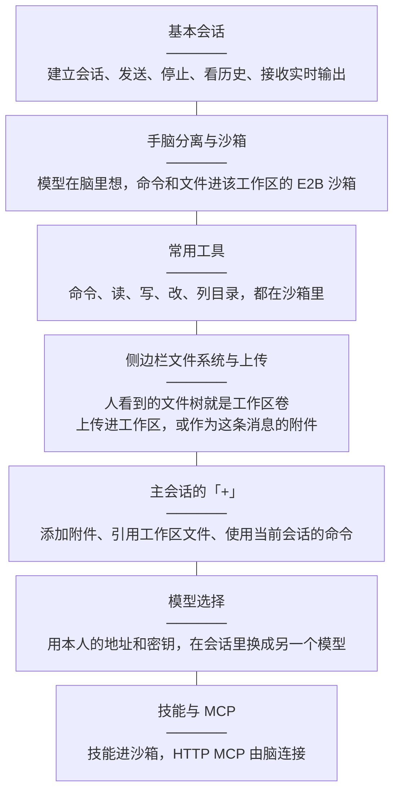

---

## 1. 手脑分离怎么落地

内核的工具插件停留在「我要读一个文件、我要跑一条命令」。它们不关心机器在哪。真正碰操作系统的是三条接缝。把这三条从「脑所在的本机」换成「当前会话对应的沙箱」，手就从脑上拆出去了。

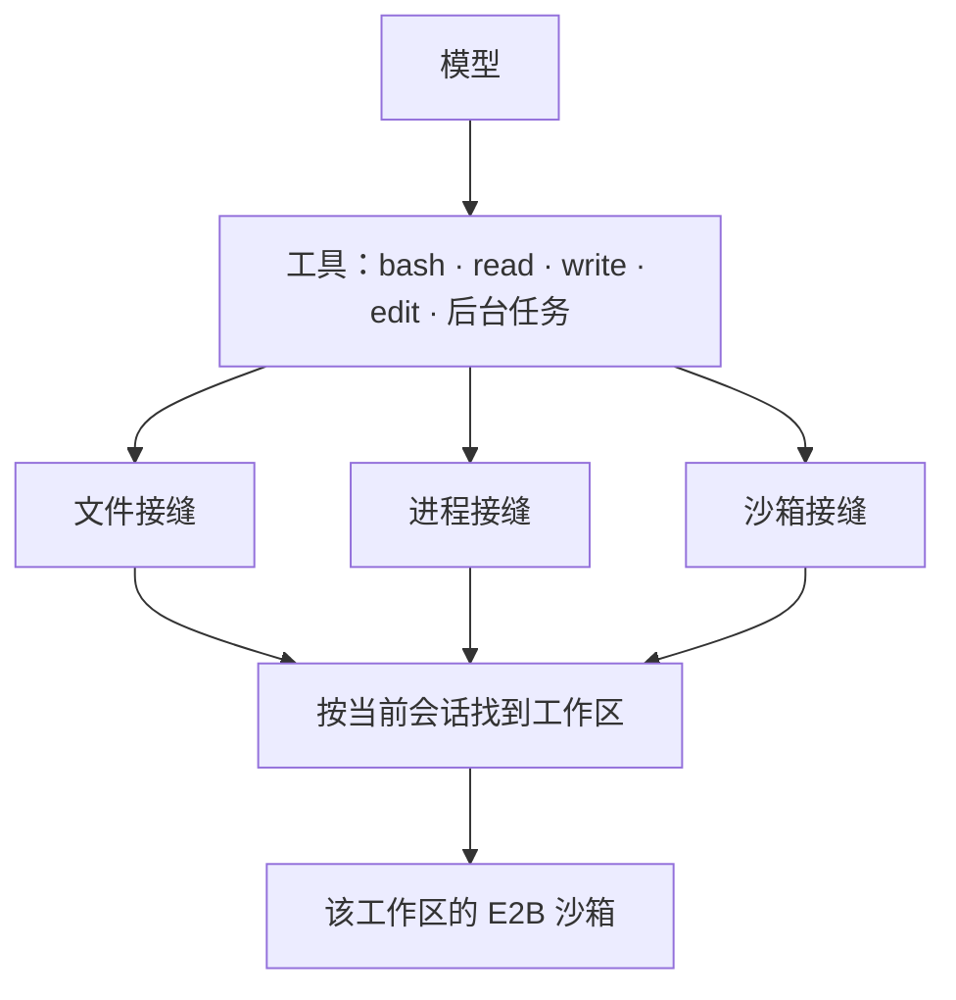

三条接缝在整个进程里仍然各只有一份，所有用户共用。不能为每个用户各装一套，因为内核在一个上下文里每种服务只有一个实例，而且有的调用根本不带用户身份，只有路径。路由必须发生在接缝内部：先问「现在是哪条会话」，再找到这条会话的工作区和沙箱。

没有当前会话的调用不能猜路径。猜错就会读到别人的文件。这种调用要么显式失败，要么只允许落在已经绑定好的那台沙箱上。

上层工具一行不改。命令工具本来就把执行交给进程接缝，所以换掉进程接缝之后，命令、由命令拉起的后台任务、以及通过子进程启动的脚本一起进入沙箱。只改命令工具、不改进程接缝，终端和脚本仍会跑在脑所在的机器上。

子代理由脑创建，平台的会话归属里没有它。解析工作区时沿着父会话向上，找到平台认得的那条祖先，和父会话共用同一台沙箱。父可以派子，子不再往下派。

---

## 2. E2B 在链路里的两层

E2B 是当前的沙箱实现，不是对上层的契约。以后换云厂商，只换适配器。注册表、文件接缝、进程接缝继续调用同一套能力。

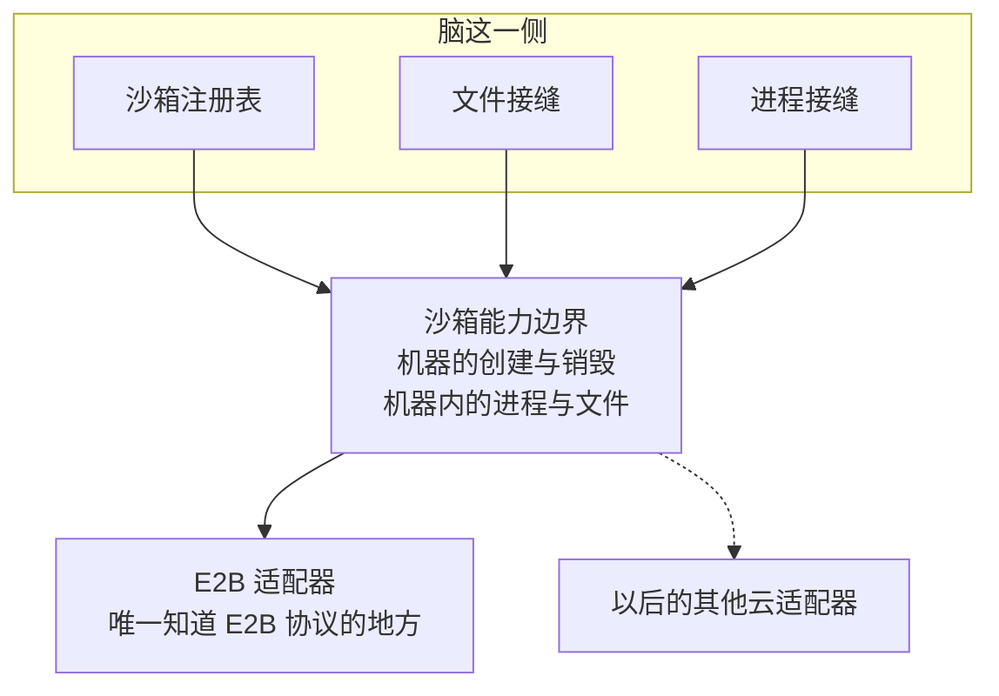

E2B 自己又分成两层，不要混在一个调用里。

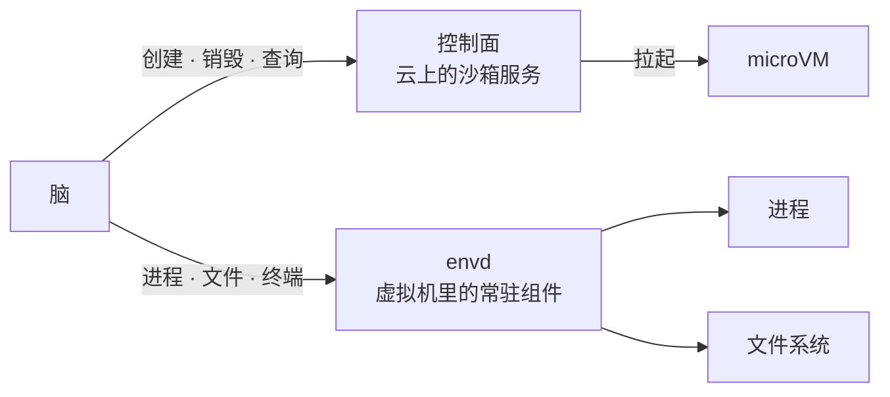

| | 控制面 | envd |
|---|---|---|
| 职责 | 把机器造出来、关掉、暂停、列出来 | 在已经造好的机器里干活 |
| 位置 | 云上的沙箱服务 | 每台 microVM 内部，镜像里就有 |
| 连接断了 | 机器还在不在，问控制面 | 机器里的进程继续跑，不跟脑的连接一起死 |

第二点决定了恢复的边界。脑重启不等于沙箱里的进程一定消失。后台任务的编号放在脑内存里，副本重启后旧编号失效，用户重新发起。交互式终端不在这次范围内。

阿里云智能体沙箱走同一套 E2B 协议。适配器不改调用方式，只换接入地址、模板和执行角色。控制面兼容层上，创建卷往往不可用，建卷走云厂商自己的卷接口。脑不建卷，只挂平台已经写好的卷名。

和以前用 SSH 再套一层文件系统隔离相比：隔离边界变成整台虚拟机。虚拟机里只挂这个工作区的目录，以及本人技能和公共技能两块只读目录。沙箱接缝因此可以直接放行，不再在脑所在的机器上包一层进程级沙箱。`workspace-write` 的含义变成「可以写这块挂载进来的工作区」，而不是「在宿主机上按目录策略限制」。

适配器对外使用我们自己的沙箱标识。云上的实例 id 只作为外部标识保存。上层只区分四类失败：不存在、暂时不可用、这台机器已经换代、未授权。云厂商的错误码留在适配器里翻译。

能力按声明使用，不按想象使用。某一家云没有伪终端，就关掉终端工具；不能重新接上已有进程的输出，就维持「重启后任务丢失」。

---

## 3. 一台沙箱的生命周期

沙箱不是会话创建时就拉起的。会话可以先恢复、先对话。注册表在第一次需要文件或进程时保证「这个工作区有一台可用的机器」。

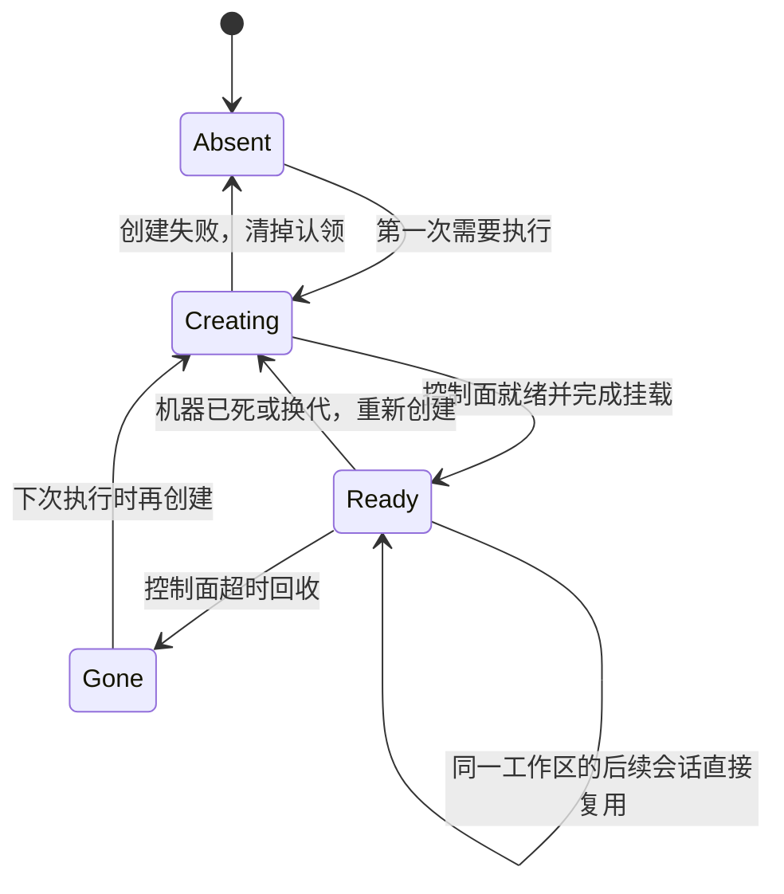

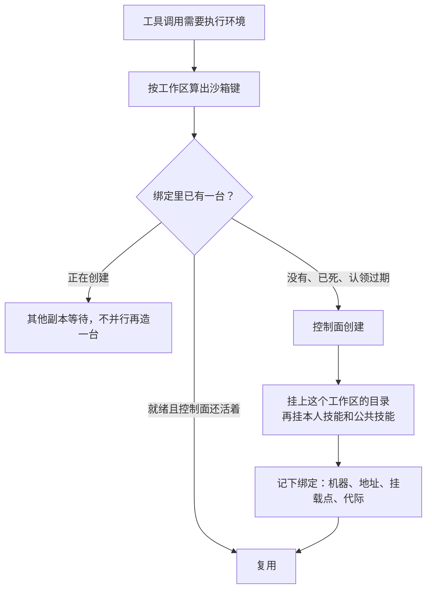

同一工作区在多台脑上同时第一次执行，只能造出一台机器。绑定上的创建认领要跨进程有效：已经有人在创建，其他人等待；认领过期才能接管。否则两台虚拟机会同时挂同一块卷写文件。

创建失败不能留下半套环境。认领要释放，已经造出来的机器要销毁。

代际在机器重建时增加。旧的任务 id 若还指向上一代机器，回答「环境已重建，该任务已结束」，而不是连到一个碰巧号码相同的进程。

空闲机器活到控制面自己的超时（按一小时量级估算），脑不另跑定时清扫。配额按「正在使用的工作区，加上超时前还没消失的残留」来留。控制面上有、绑定里没有的孤儿机器，通过对账手工处理。

当前会话的入口只有一处需要知道「现在是哪条会话」。文件和进程接缝不自己解析身份，它们向注册表要当前沙箱。

---

## 4. 粒度、卷和挂载

三种粒度只差键怎么取，绑定和创建流程相同。本方案固定为**每个工作区一台**。

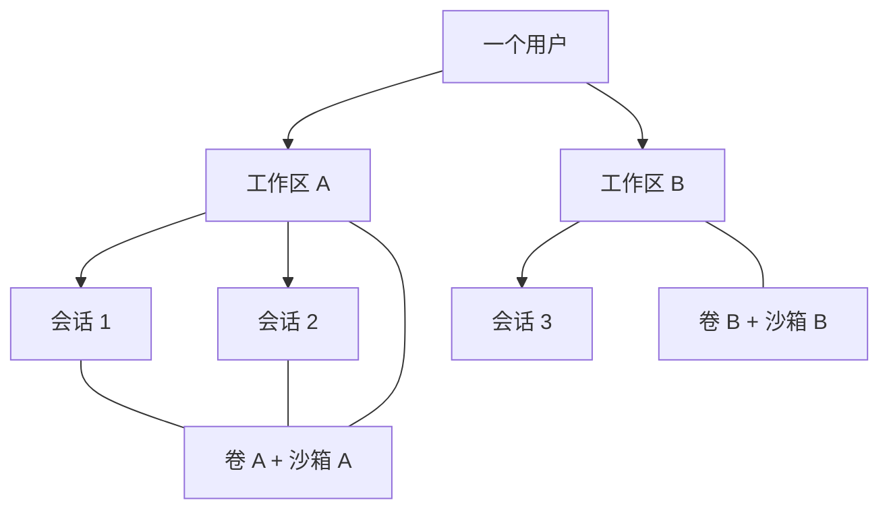

同一工作区的会话共享读写、进程和网络。这是故意的：同一个人会并行开几个会话处理同一个项目。不同工作区之间没有共享文件。跨项目改文件、monorepo 式的互相引用，在这档粒度下做不到。

已经跑起来的会话不因配置变更中途换机器。粒度在这台沙箱第一次创建时定死。以后若调整粒度，只影响新建的工作区，并回收按旧粒度留下的机器。

卷和虚拟机分开。

卷名来自工作区标识，不用显示名称。名称会重复，标识不会。清洗卷名时如果发生截断，补上标识摘要，避免两个工作区落到同一块卷。

平台和脑对挂载点只有一个说法：工作区记录里的沙箱内根目录。会话工作目录用它，文件回填用它，脑挂卷也用它。记录为空时，脑才按约定模板回退。根目录不是绝对路径、或等于整台机器的根，则拒绝创建沙箱。

没有「缺省共用卷」。解析不出这个工作区自己的卷，就失败。临时把所有工作区挂到同一块已有卷上，只适合联调，多用户时隔离不成立。

一块卷在一台沙箱上就是整卷挂载，没有再切子目录的参数。隔离靠建卷时就把存储前缀定到这个工作区，而不是靠挂载之后再限制路径。

技能再挂两块，见第 10 节：本人技能和公共技能。一台沙箱同时挂工作区、本人技能、公共技能。云上对单台机器的挂载数量有上限，三块在限额以内。

---

## 5. 多副本和冷恢复

脑可以水平扩展。一台副本同时服务多个用户、多条会话。副本上不保留不可重建的会话状态。

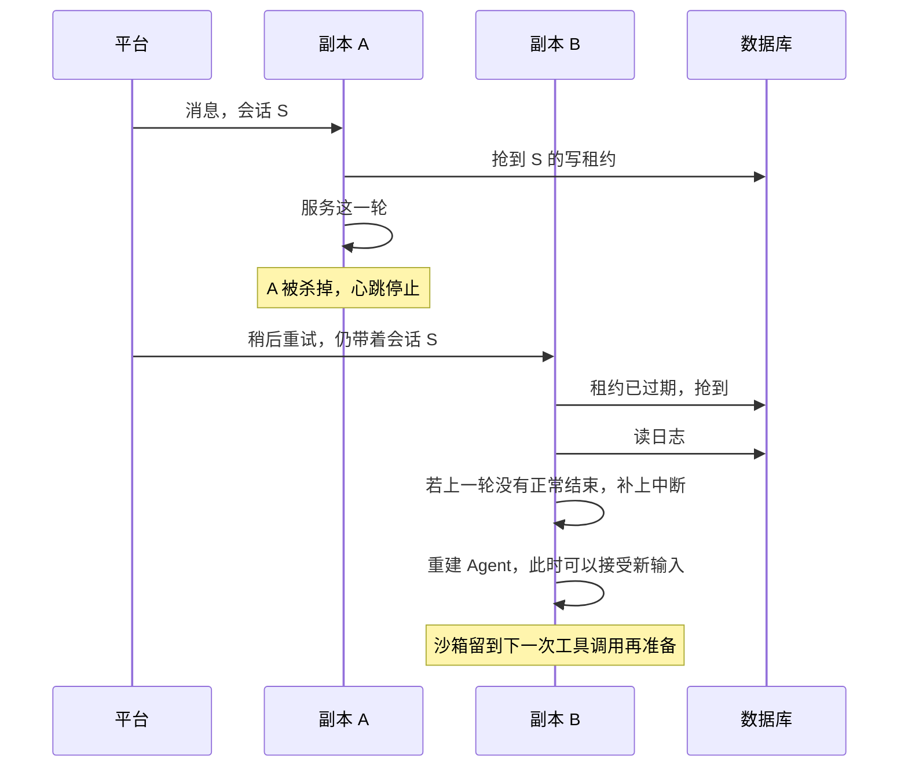

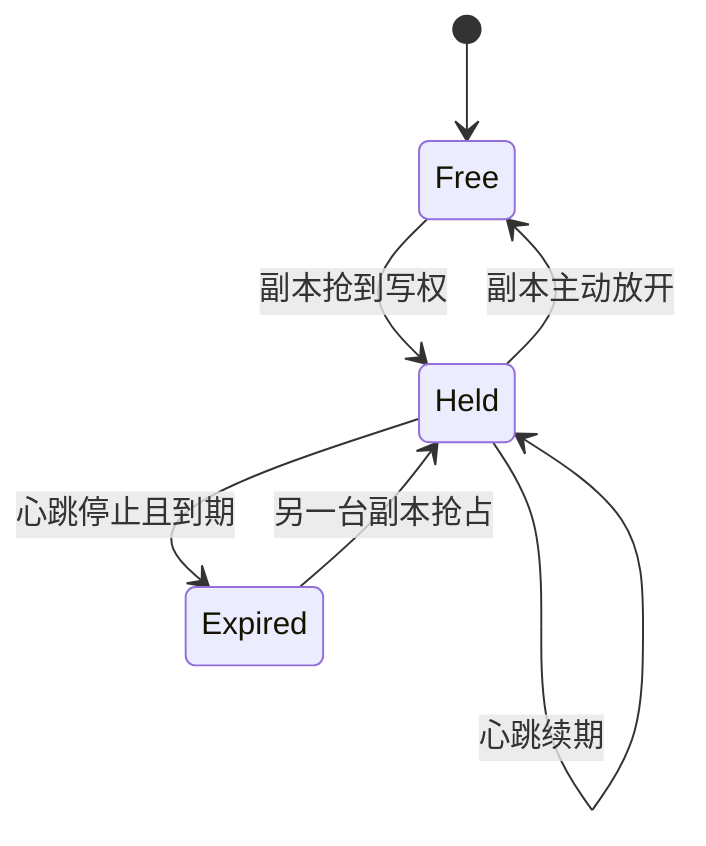

心跳大约 5 秒，租约大约 30 秒。太短会出现两个写者；太长会让会话在死副本上锁住。宁可略长。进程被强杀后，最多等一个租约周期才能被别人接上。发布时要先停收新请求、放开租约，再退出，避免每次发布都卡满这一段。

平台看到「正忙」就按这个周期重试，不把消息再投递一遍去赌工具没执行过。消息是否已经交给脑，由平台自己的投递记录决定；结果未知就不自动重发。

写租约的持有者记成副本的稳定名字，便于看出是谁占着。平台不根据这个名字把请求转过去。亲和由入口按会话做；亲和打偏了，就靠抢租约或等待，而不是平台维护一份副本目录。

日志是事实来源，租约是写权来源。即便租约判断失误，后写入的一方也必须在追加日志时撞上冲突，而不能写出两份互相覆盖的历史。模型可见的历史从日志投影。已经写下的事件不修改；要纠正，就追加新事件。

冷恢复做这些事：读连续的日志、把没写完的工具调用和步骤收束掉、把没结束的轮次标成中断、按原来的预设重建 Agent。

冷恢复不做这些事：不重跑被打断的那一轮，不提前创建沙箱，不自动继续无人值守的目标轮次。目标本身在日志里还在，但是否继续跑，要等下一条用户消息。自动一轮接一轮的目标驱动先关闭，否则无人看管时会持续消耗用户自己的模型额度。

子代理的调度状态在脑内存里。副本死亡时，恢复逻辑要给还在等待的父级一条「子代理已中断」。不做这一步，父级会一直等。

大块工具结果不能只写在某一台副本的本地盘上。日志里如果只留一个本地引用，换副本就读不回来。要么不要这种外溢，要么外溢到共享存储。图片等附件同样放在共享对象存储，不放副本本地目录。

---

## 6. 常用工具落在哪一侧

判断标准只有一条：这个工具背后的能力，有没有经过文件接缝或进程接缝进入 E2B。人和模型看的是同一棵工作区文件树，所以列目录、搜索也必须进沙箱，不能去扫脑所在机器上的磁盘。

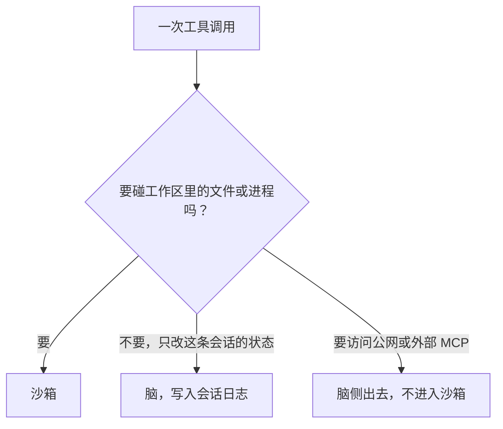

| 能力 | 落点 |
|---|---|
| 执行命令 | 沙箱 |
| 读、写、改文件 | 沙箱 |
| 列目录、在工作区里搜索 | 沙箱。搜索程序跑在沙箱里，不用脑本机上的路径 |
| 后台任务的列表、输出、终止 | 进程在沙箱，编号在脑内存。副本重启后旧编号失效 |
| 子代理及其消息 | 脑调度，执行共享父沙箱。深度只到一层 |
| 匿名抓取网页 | 脑侧，按用户限制并发 |
| 目标、待办、计划 | 只写当前会话，不自动一轮接一轮跑 |
| 用户技能 | 目录按该用户的启用记录决定，正文和脚本在沙箱 |
| 用户配置的 HTTP MCP | 脑侧连接外部服务 |
| 读取图片和消息附件 | 字节在共享存储，换一台脑也能读 |

工作目录保持在这个工作区的挂载点上，模型不能把会话切到挂载点外面。stdio 形态的 MCP、工作流编排、交互式终端不进入这次的范围：前两个会在脑所在机器上执行或把状态留在进程内存里，终端要跨重启接回还缺持久编号。

预设里不写某个工具，不等于模型看不见它。内核在更外层注册过的工具，要在这个部署的配置里显式关掉。上线前用一条真实会话里模型拿到的工具清单核对。

这套部署没有人在旁边点批准。工具调用不再进入审批等待。能写的范围仍由工作区卷和虚拟机决定。

---

## 7. 侧边栏文件系统

侧边栏里的文件树就是这个工作区的根，也就是沙箱挂上的那块卷。人在边上看到的，和模型用读文件工具看到的，是同一份。

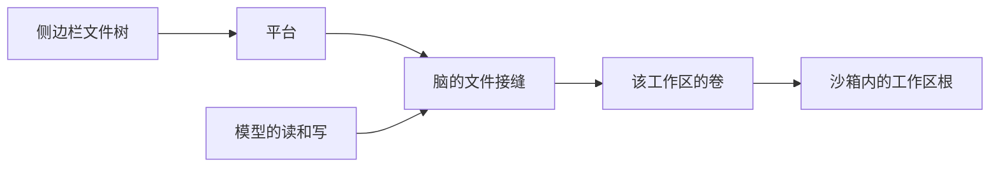

打开某个目录时，如果这台沙箱还没有，就按注册表的规则准备好再列。列出来的只有这块卷里的内容，没有脑的磁盘，也没有别的工作区。换工作区就换一棵树。

人在侧边栏里改到的路径，模型下一次读同一个路径能看见。模型写进去的文件，侧边栏刷新后也在。两边不各存一份。

---

## 8. 文件上传

上传有两条路，都要能换脑副本之后继续用。

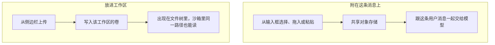

消息附件不写进某一台副本的本地盘。图片和文件的字节放在共享存储里，日志里只留引用。另一台脑接过这条会话时，仍能把附件读出来给模型。

放进工作区的文件直接进卷，不经过「先存在脑上、再拷进沙箱」。上传当时沙箱可以还没创建，卷已经在；下次执行或打开文件树时挂上同一块卷即可。

上传的目标必须落在这个用户的这个工作区里。不能通过路径写到别的工作区，也不能写到技能目录。

---

## 9. 主会话里的「+」

主会话输入框上的「+」，这次带上和当前会话直接相关的几项，而不是把单机界面里的终端、日程、插件市场一起搬过来。

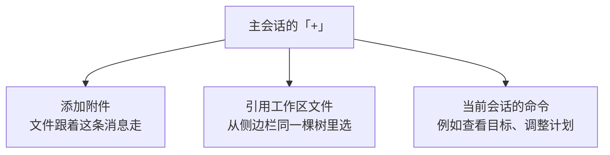

引用文件时，候选来自第 7 节的文件树。选中的是工作区里的路径，模型收到的是这个路径，而不是把脑所在机器上的一份拷贝塞进上下文。

附件走第 8 节的消息附件。命令只作用于当前这条会话，改的是会话自己的状态，不改别的用户。

「+」里暂时没有对应运行时的项，不放进菜单，避免点了没有结果。

---

## 10. 技能怎么进沙箱

技能按条配置。用户一条一条上传、启用、停用。没有合集，也不把技能再分配给个别工作区。分本人和公共两套。本人的只对这个成员生效；公共的由管理员维护，所有成员的新会话都能用。同名时本人的那条盖过公共的。

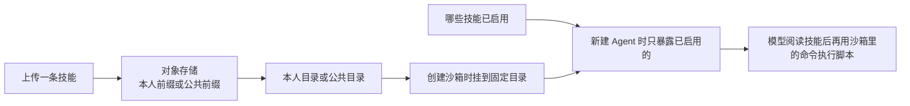

两块都只读，路径在所有沙箱上相同。本人技能的对象前缀是 `members/{成员}/skills`，挂到 `/skillbox/own`。公共技能的对象前缀是 `common/skills`，挂到 `/skillbox/common`。这样技能正文里的相对路径在两侧一致。本人前缀只含这个成员，挂进 A 的机器里看不到 B 的目录。不要把所有人的技能放进同一个前缀再整段挂进去：进程能读到同前缀下的其他目录，隔离就没了。

脑不接收平台推过来的技能清单，也不替用户写文件。平台负责上传和启用状态。脑在创建 Agent 时自己读这个用户的启用记录，再通过沙箱里的文件系统读技能正文。这样技能脚本和资源走的就是手，而不是脑的磁盘。

启用记录放在 Agent 自己的范围里，不放在全体共用的全局范围。全局一份的话，所有用户会看见同一套技能。

内置的「去扫脑所在机器上的技能目录」关掉。那扫到的是脑的磁盘，不是挂进沙箱的技能目录。

已经在跑的 Agent 保持创建时的那一份。上传或停用影响之后新建的 Agent。对象存储的可见性可能有短暂延迟，以新建会话时卷上已经能读到文件为准。

两块技能目录按只读挂上。工作区目录可写，对象前缀是 `desks/{工作区}`，沙箱内根目录是 `/desk/{工作区}`。

子代理沿父会话找到用户，再加载这个用户的技能。

---

## 11. MCP 放在脑侧

MCP 也按条配置：一个名称、一个远程地址、超时、若干请求头。只使用可以远程连接的 HTTP。stdio 会在脑所在的机器上启动用户给出的程序，不采用。

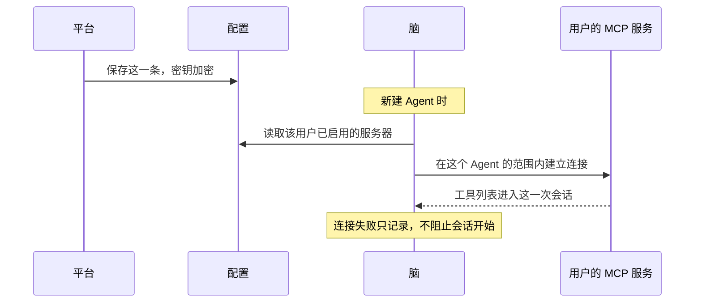

密钥解密后只出现在脑发往该 MCP 的请求头里。沙箱里执行命令看不到这些头。配置修改对已经活着的 Agent 不生效。

工具名带上服务器名称，避免不同服务器的工具撞名。单个用户的服务器数量要有上限，因为连接数会随活跃用户和每人的服务器数增长。数量上去之后再收成每用户一个网关，不在脑上放开任意本机进程。

地址默认只接受公网。内网地址由部署显式允许，不由用户在配置里绕过。

---

## 12. 模型选择

每个用户在平台保存自己的接口地址和密钥，并在这个地址下填写可用的模型名，指定一个默认模型。没有全体共用的密钥，也不代用户查询套餐额度。

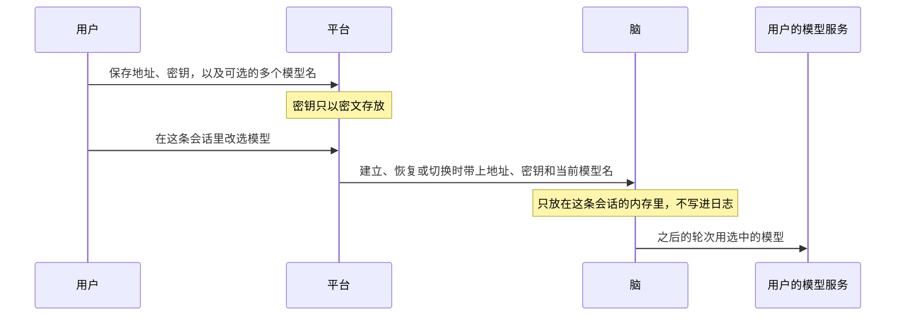

地址或密钥缺了，就不能建立新会话。脑上没有一份可以回落的全局密钥。切换只影响这条会话之后的轮次，不改写已经发生的对话，也不换别人的密钥。可选模型来自这个用户自己保存的名单。

---

## 13. 用户和归属

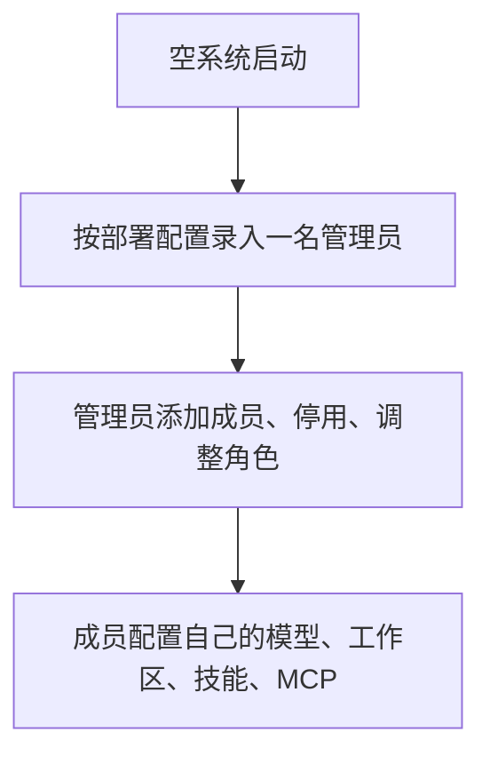

停用立即生效。至少保留一名可用的管理员。成员之间的会话、工作区、技能和密钥互不可见。管理员可以查看用户和沙箱的归属，用来排障，不通过管理入口去读成员的对话内容。

会话 id 能定位一条对话，它不是登录凭据。谁可以打开它，在平台判断。脑收到的用户标识由平台写入，不接受客户端自己声称的身份。对不上归属时，当作这条会话不存在，避免泄露「id 存在但不属于你」。

工作区归档之后不再新建会话，已经发生的对话仍可回看。

---

## 14. 浏览器

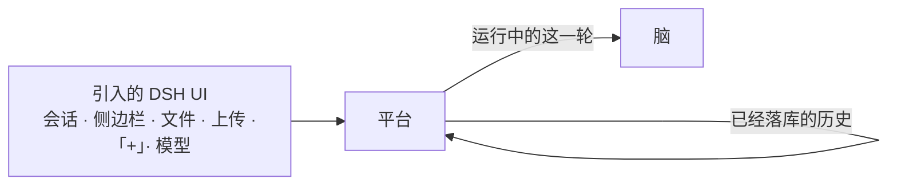

主客户端不自己写代码。引入 DSH 客户端的 UI，版本与内核锁定。主会话、侧边栏文件树、上传、「+」、模型选择、技能和 MCP，都是这套 UI 里的能力，不另做页面。文件树和「+」里的引用指向当前工作区的卷。

这套 UI 原来对着单机上的那一台脑。多用户之后，它只连平台。谁可以看哪条会话，由平台判断。脑上不安装这套界面。

流式的半截文字只存在于持有该会话的那台脑上，所以这一段连接要跟会话走同一条亲和路径。已经写完的事件从数据库读，任意平台副本都能读。先订阅再补历史，避免中间刚好写完的事件被漏掉。

终端、工作流、在用户电脑上打开目录，不从这套 UI 里打开。

---

## 15. 失败时用户看到什么

| 发生了什么 | 系统怎么处理 | 用户侧 |
|---|---|---|
| 脑副本崩溃 | 当前轮次作废，租约到期后另一台从日志恢复 | 这一轮中断，可以再发 |
| 两个副本同时写 | 租约只让一个成功，日志追加再挡一层 | 不应发生数据分叉 |
| 沙箱创建失败 | 工具调用失败，不把失败记成永久不可用 | 执行环境不可用 |
| 沙箱创建慢 | 不阻塞模型先说话 | 第一次执行时等待 |
| 沙箱被超时回收 | 下次执行重新创建，卷还在 | 环境重置，文件还在 |
| 机器内组件暂时连不上 | 不重试那些不知道有没有执行完的操作 | 执行环境断开 |
| 消息发出后结果未知 | 不自动再发一次 | 提示结果未知 |
| 技能或 MCP 在会话中途改了 | 当前 Agent 保持原样 | 新会话才看到新配置 |
| 子代理时脑重启 | 父级收到中断 | 这个子任务需要重做 |

红线只有一条：任何情况下都不能有两个副本同时写同一条会话。

---

## 16. 部署形态

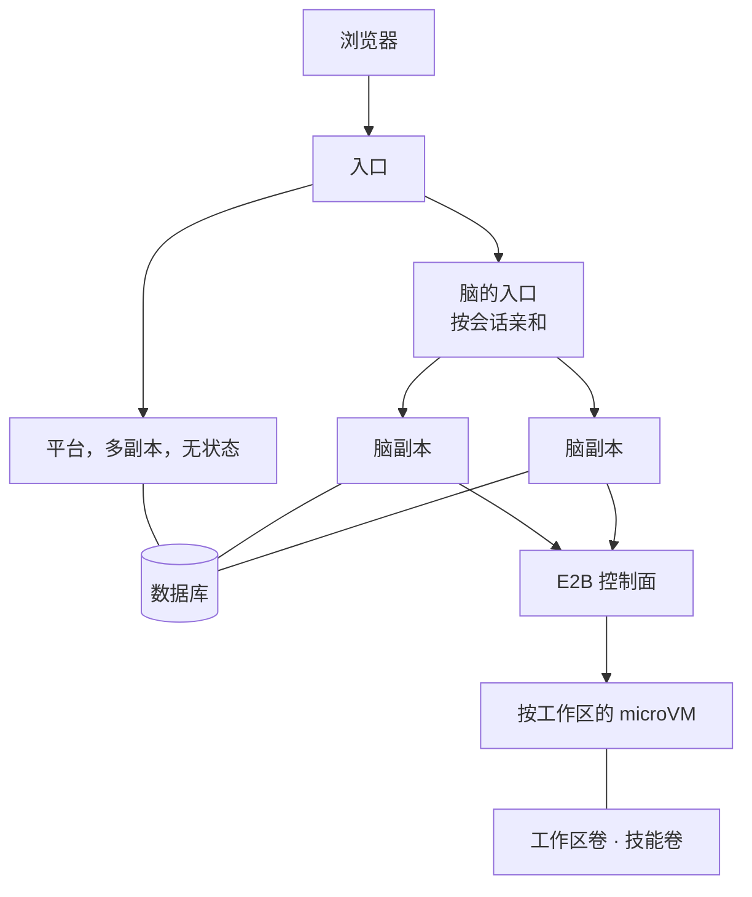

平台和脑分成两个部署，共用一个数据库，写的东西分开。平台写用户、工作区、会话归属、技能与 MCP 的配置、消息有没有投递出去。脑写会话日志、写租约、沙箱绑定。平台读日志来做历史。

脑的界面相关组件不安装。配置集中在这一份部署的 profile 里：数据库、沙箱接入、调用方凭据、要关掉的工具。同一个配置项只出现一次，换环境改这一份再重启。

密钥来自部署注入，不写进镜像。脑监听自己的具体地址。收到退出信号时先放开租约。

内核版本锁定为发布标签 `dsh-v0.2.2-rc.3`（npm 包 `@deepseek-ai/dsh@0.2.2-rc.3`）。客户端 UI 用同一标签。升级时整包替换，并重跑同一条契约：建会话、在沙箱里跑命令、侧边栏能看见工作区文件、上传后模型和文件树都能读到、会话里能切换模型、技能和 HTTP MCP 出现在新会话中、杀掉持有会话的副本后另一台接着对话、两个工作区的文件互不可见。
