# 阿里云沙箱

当前沙箱运行时是阿里云 Agent Sandbox 的 E2B 兼容接口。脑不改内核，只把文件和命令从脑所在的机器换到远程沙箱。本文只讲这台机器在阿里云上怎么造出来、请求怎么进去。手脑怎么分、工作区怎么隔离，不在这里重复。

---

## 1. 控制面和数据面分开

阿里云这边实际有两套入口，不要混用。

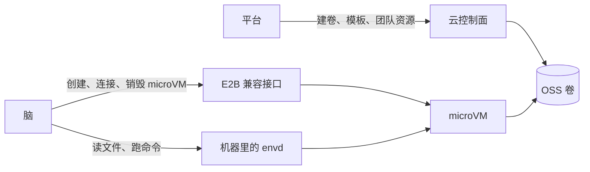

| | 云控制面 | E2B 兼容接口 |
|---|---|---|
| 谁调用 | 平台 | 脑 |
| 用来做什么 | 把工作区前缀登记成可挂载的卷，管理模板 | 按模板恢复一台 microVM，挂上已经存在的卷 |
| 不做什么 | 不执行模型的工具，也没有「创建一台给这次对话用的沙箱」这种运行接口 | 不在阿里云这一侧创建卷。建卷接口是关掉的 |

Kubernetes Pod 那条接口只有终端和批量命令，没有成套的文件能力，不用它跑工具。

脑只知道 E2B：创建、连接、查询、销毁、进程、文件，以及创建时带上卷名和执行角色。接入地址是地域上的 `api.<region>.sandbox.aliyuncs.com`，数据面域名是 `<region>.sandbox.aliyuncs.com`。模板、密钥、执行角色由部署注入。换地域只换这组地址和模板，不换脑里的执行路径。

执行角色在创建时下发，用来让这台沙箱访问它该访问的 OSS。角色不写进模板镜像。

---

## 2. E2B 的两层

控制面只负责造机器。命令和文件直接打进虚拟机里的 envd，不绕回控制面。

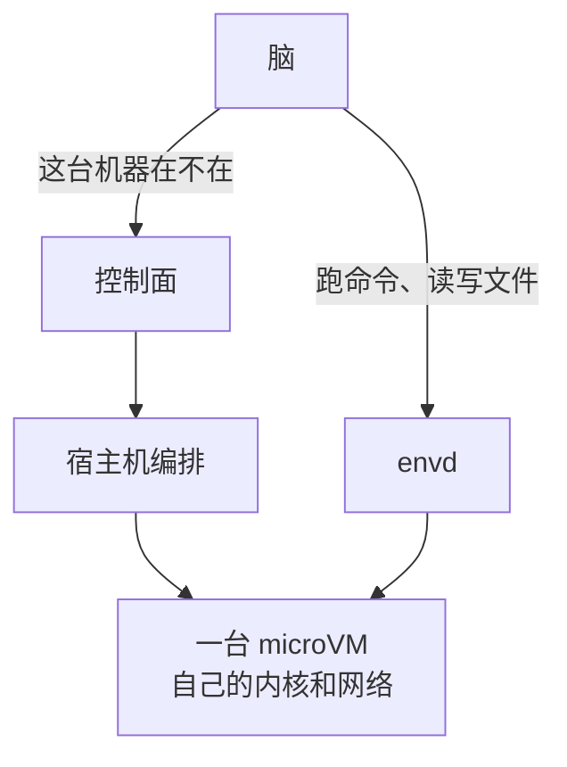

创建不是冷开机，是恢复一份已经启动好的模板快照。内存按缺页再加载，根盘是写时复制。

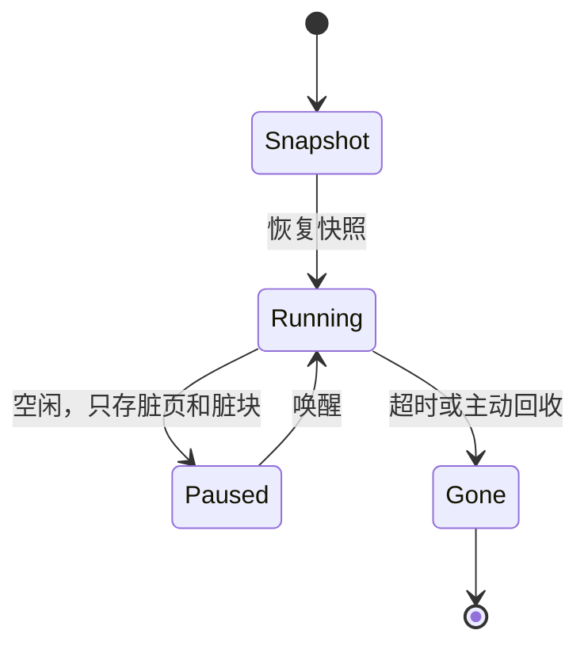

三样东西比单次虚拟机活得久：

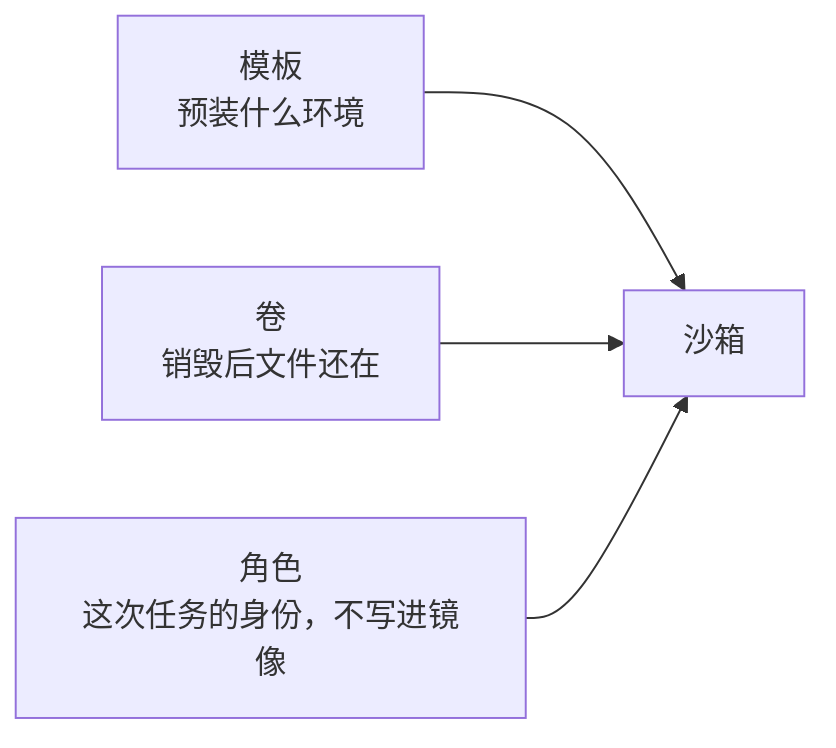

连接断了，虚拟机里的进程还在。脑重启后能不能接着用，看绑定还能不能找到这台机器。当前回收靠控制面超时，不靠暂停。协议里有暂停和快照；阿里云二代在开通之后才有 Checkpoint 和一对多复制，一代没有。

---

## 3. 阿里云二代是轻量虚拟机

MicroVM 是一类轻量虚拟机，不是某一家的产品名。E2B 开源节点上，拉起的是 Firecracker：一台沙箱一个进程，跑在 KVM 上，只虚拟网卡和磁盘，外面再套 cgroup。阿里云二代借用了 MicroVM 这个名字，公开材料写的是轻量虚拟机、可跑 Linux 和 Windows，没有点名它就是 Firecracker。兼容的是对外动作，不是节点上的进程名。

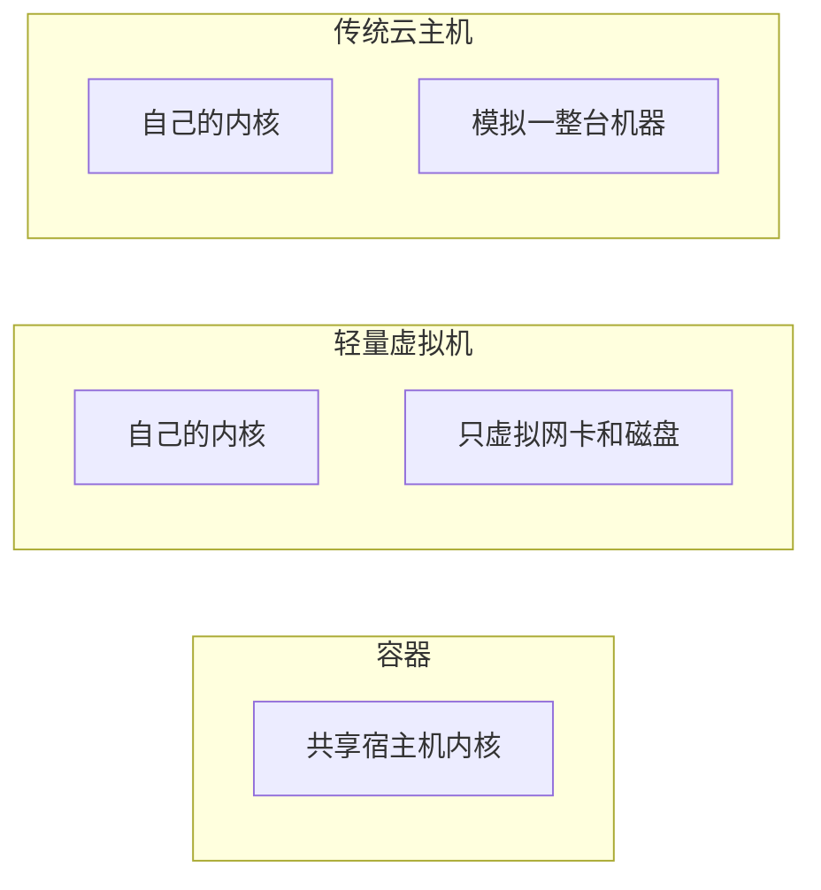

| | 容器 | 轻量虚拟机 | 传统云主机 |
|---|---|---|---|
| 内核 | 和宿主机共用 | 每台沙箱自己一份 | 每台自己一份 |
| 启动 | 最快 | 快照恢复可以到几十到几百毫秒 | 秒到分钟 |
| 逃逸要打穿 | 宿主机内核 | 虚拟化边界 | 虚拟化边界 |

沙箱里的系统调用进不了宿主机内核。容器快，是因为不启动第二份内核；传统虚拟机慢，是因为先模拟一整台电脑。这里选轻量虚拟机，是因为模型生成的命令不可信，不能和脑共用一个内核。

---

## 4. 和直接起一个 Pod 差在哪

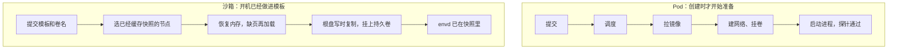

启动快，是因为拉镜像、启动内核、跑完开机脚本发生在做模板的时候。创建只是把那份快照恢复起来。

| | 根盘上的改动 | 持久卷 | 正在跑的进程 |
|---|---|---|---|
| 沙箱销毁 | 消失 | 还在，下一台再挂 | 消失 |
| 暂停 | 脏块留下 | 还在 | 和内存一起冻住 |

工作区文件走持久卷，对话走数据库。所以沙箱销毁后文件还在，正在跑的进程不在。当前不靠暂停把进程留下来。

创建成功之后，命令不再穿过控制面。envd 是快照里已经跑着的服务，脑拿到地址后直接访问。这和每次 `exec` 都要穿过 API、并且连接结束进程就没了，不是同一条路。

---

## 5. 一台沙箱怎么造出来

下面按 E2B 开源实现讲节点内部，用来理解「创建成功」时机器已经能执行命令。阿里云兼容的是这组对外动作，放置算法和进程名不在协议里。

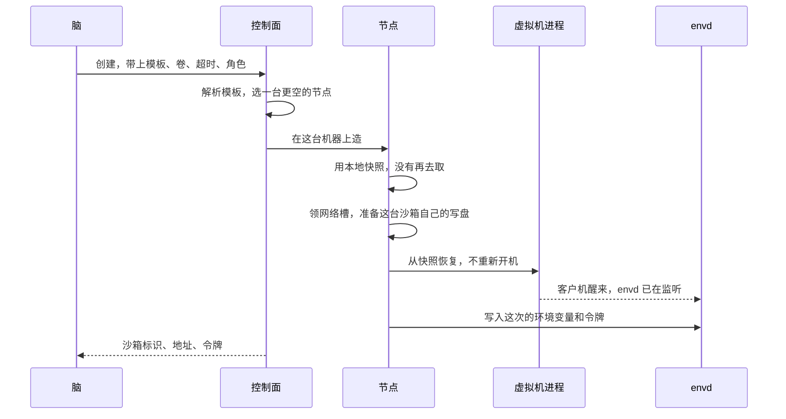

控制面要等 envd 应答才返回成功。返回的时候，机器已经能执行命令。

| 快照里就有 | 创建时才放进去 | 创建之后才有 |
|---|---|---|
| 客户机内核、envd | 这次的环境变量、访问令牌、执行角色 | 脑让 envd 启动的命令 |
| 模板里预装的工具链 | 要挂的持久卷、超时 | 命令拉起的子进程 |
| | | 工作区文件，来自挂上的卷 |

envd 对脑暴露进程、文件和指标。初始化、暂停时的冻结只给节点上的编排，从沙箱的公网地址访问不到。

---

## 6. 请求怎么进到这台虚拟机

脑不拿着节点 IP 去连。域名解析到边缘，边缘再查这台沙箱现在在哪。这是 HTTP 反向代理，不是把原始数据包一直转发进虚拟机。

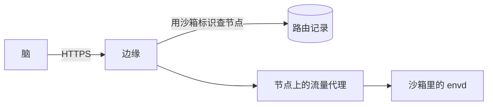

地址本身带着沙箱标识和端口。envd 的端口是 49983。阿里云的域名形状是各地域的 `*.sandbox.aliyuncs.com`。

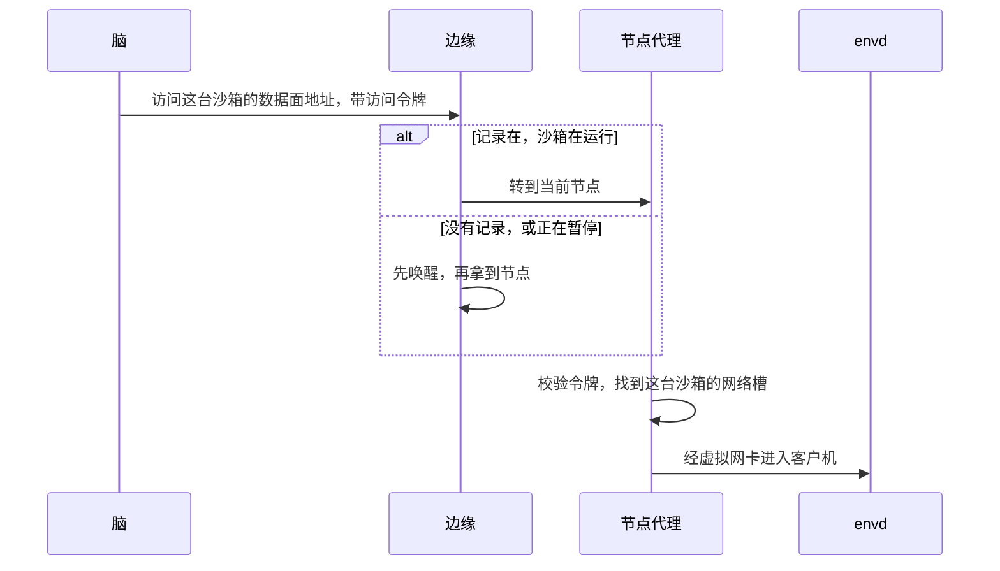

路由记录在 envd 就绪时写成「沙箱标识 → 本节点」。暂停或销毁时删掉，并带上这一次运行的标识，避免旧记录清掉新一次运行。沙箱换节点，或者从暂停里被唤醒到另一台机器，改的是这一条记录，脑不用换地址。

公网只能打到进程、文件和用户自己监听的端口。初始化这类控制接口在节点这一跳就被拒绝。

---

## 7. 卷先于沙箱，而且不走 E2B 的建卷

阿里云的 E2B 兼容层把创建卷关掉了。列出卷可以用来核对，创建必须走云控制面自己的建卷接口。平台建工作区时完成这件事，脑只读已经写好的卷名。

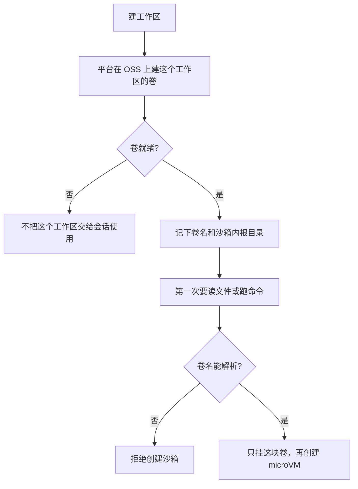

同一个 bucket 用不同前缀分工作区。挂载没有子目录参数，所以隔离要在建卷时把前缀定死，不能挂一块大卷再指望路径不要越界。解析失败不退回一块大家共用的卷，也不退回空目录。共用卷是最安静的事故：调用成功了，一个工作区的会话却改到另一个工作区的文件。

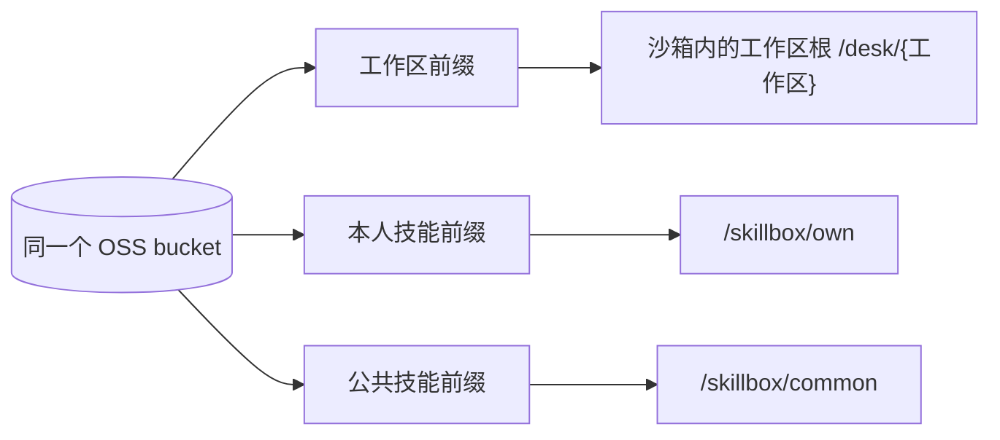

技能挂两块，都只读。本人技能前缀 `members/{成员}/skills`，公共技能前缀 `common/skills`。工作区前缀是 `desks/{工作区}`。三块一起挂上。一台沙箱能挂的数量有上限，三块在限额以内。卷和密钥必须属于同一个团队。执行角色需要这些前缀上的列举、读取、写入和分片相关权限。不使用 OSS 的 SSE-KMS。

挂载点只有一个说法：工作区记录里的沙箱内根目录。会话的工作目录用它，上传进工作区也用它，脑挂卷也用它。根目录不是绝对路径，或等于整台机器的根，就拒绝创建。

卷名用工作区标识，不用显示名。清洗造成截断时补上标识摘要，避免两个工作区落到同一块卷。

---

## 8. 多副本只能建成一台

两台脑同时发现「这个工作区还没有沙箱」，会各建一台，再写同一块卷。

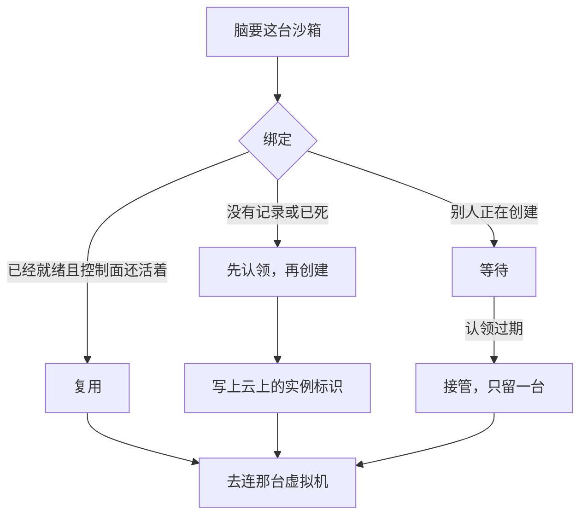

我们自己的沙箱标识和云上的实例标识分开。换运行时之后，历史绑定不会因为云上的 id 规则变了就全部失效。

脑重启不等虚拟机。先把 Agent 从会话日志里恢复，第一次工具调用才连接。沙箱还在，进程和文件都还在；已经被回收，就挂同一块卷新建一台。对话不在沙箱里。回收只丢掉还没结束的前台进程。

---

## 9. 换云时什么不变

阿里云提供的是内核隔离，以及把开机压成恢复快照。用户、工作区、哪一次调用进哪一台、多副本只能建成一台，仍由我们自己定。

换一家同样按「模板、卷、创建、销毁」组织的云，只换适配器。文件接缝和进程接缝不改。某一家没有的能力就关掉对应工具：没有伪终端就不要终端，不能重新接上已有进程的输出，就接受重启后任务编号失效。

上层只区分四类失败：不存在、暂时不可用、这台机器已经换代、未授权。云厂商的错误码留在适配器里翻译。
